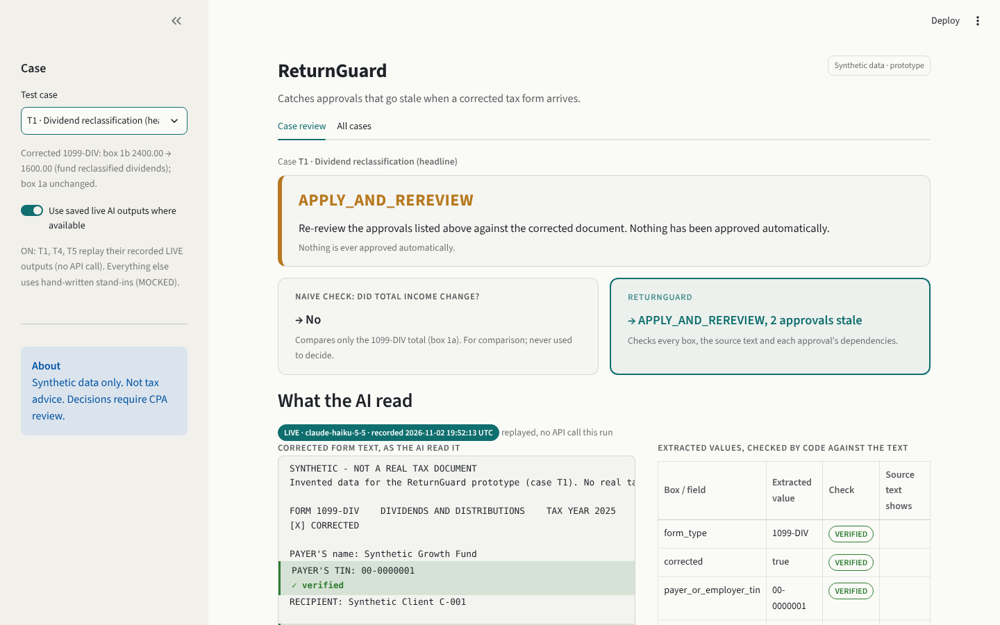
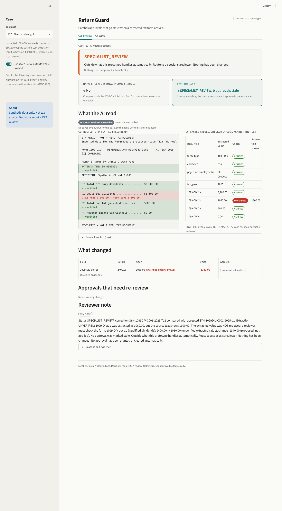
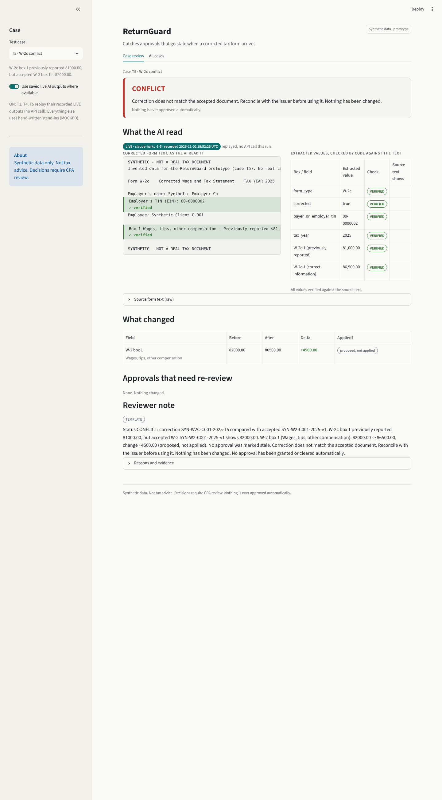

# ReturnGuard

**Catches approvals that go stale when a corrected tax form arrives.**

A corrected 1099-DIV or W-2c can arrive after a CPA has already approved work based on the original.
ReturnGuard works out what changed, whether the correction can be trusted, which approvals are now stale,
and what the reviewer should do next. **AI suggests, code verifies, a CPA decides.** It never computes tax,
never files anything and never approves or clears anything automatically.

Take-home prototype for MiraFlores AI (AI Engineer, Tax). **Synthetic data only. Not tax advice.**



---

## 1. Quick start

Requires **Python 3.11+ (tested on 3.13)**. No API key, no network, no paid service.

Clone with `-b main`: `main` is the source of truth.

```bash
git clone -b main https://github.com/sakshiasati17/MiraFlores-Takehome.git
```

```bash
cd MiraFlores-Takehome
```

```bash
python3 -m venv .venv
```

```bash
source .venv/bin/activate
```

```bash
pip install -r requirements.txt
```

```bash
python3 -m pytest -q
```

```bash
python3 cli.py --all
```

Start the UI last: it keeps running in this terminal until Ctrl+C (open http://localhost:8501).

```bash
streamlit run app.py
```

Dependencies (`requirements.txt`, pinned): pydantic 2.13.5, PyYAML 6.0.3, pytest 9.2.0, streamlit 1.66.1.
`requirements-llm.txt` (the `anthropic` SDK) is optional and only needed for live AI extraction (section 8).

## 2. Demo path (15 minutes)

| Step | Case | What to look at |
| --- | --- | --- |
| 1 | **T1** Dividend reclassification | The naive "did total income change?" check says **No** (box 1a is unchanged), but ReturnGuard finds 1b 2400.00 -> 1600.00 (**-800.00**) and marks **2 approvals stale** (Form 1040 line 3a, QDCG worksheet). The AI read is LIVE and every value is ✓ verified against the form text. |
| 2 | **T12** AI misread caught | The AI read box 1b as 1060.00, but the form says 1,600.00. The line is highlighted red, the value is UNVERIFIED and **not replaced**, and the case goes to SPECIALIST_REVIEW. |
| 3 | **T5** W-2c conflict | The AI read is correct, but the W-2c says "previously reported 81,000.00" while the accepted W-2 shows 82,000.00. Result: **CONFLICT**. Nothing is applied and no approval is marked stale. |
| 4 | **T3** Already filed | Same correction as T1, but the return is FILED, so the result is **POSSIBLE_AMENDMENT**. The correction is recorded as a new version but NOT applied; the CPA decides whether to amend. |

Then open the **All cases** tab (15 of 15 match), show `config/` and run `python3 -m pytest -q`.

| T12: AI misread caught | T5: W-2c conflict |
| --- | --- |
|  |  |

Full T1 page: [docs/screenshots/T1.png](docs/screenshots/T1.png). All cases tab: [docs/screenshots/all_cases.png](docs/screenshots/all_cases.png).

## 3. How it works

1. **Extract**: an LLM reads the corrected form's text into a fixed JSON schema (form type, corrected flag,
   TIN, tax year, boxes). The schema has no status, decision or advice. The prompt lists the forms defined in
   `config/forms.yaml`. By default this replays a saved output; only the CLI's `--live` flag calls the API.
2. **Verify against the source**: code finds the one line for each box (box id + label from `config/forms.yaml`)
   and checks that the extracted amount is the amount on that line. A failure becomes `EXTRACTION_UNVERIFIED`
   and the value is never "fixed".
3. **Check the correction**: identity (client, tax year, payer/employer TIN), CORRECTED flag, W-2c "previously
   reported" equals the accepted value, form rules (1b <= 1a, non-negative, 2 dp), supported fields only.
   All money is `decimal.Decimal`.
4. **Dependency walk**: `config/dependencies.yaml` maps field -> return line -> approval. The dependency walk
   (`impact.py`) decides which approvals a changed field makes stale. SHA-256 evidence fingerprints over the fields
   each approval was based on give before-and-after traceability; they do not decide staleness.
5. **One status**: exactly one of six statuses (priority below).
6. **Grounded note**: an LLM may draft the reviewer note, but any number in it that is not a checked fact
   rejects the note and a template note is used instead. A money-formatted number (`$` or 2 decimals) must equal
   a real amount or delta; box ids, line numbers and the tax year count only as plain numbers.
7. **Audit log**: one append-only JSON line per decision (`out/audit_log.jsonl`, CLI only).

**Status priority (first match wins):**
`REJECTED_INVALID_INPUT` > `SPECIALIST_REVIEW` > `CONFLICT` > `DUPLICATE_NO_CHANGE` > `POSSIBLE_AMENDMENT` > `APPLY_AND_REREVIEW`

Rules live in config: adding a form or a field is a config and data change with **no Python change** (see below).
A form type that `config/forms.yaml` does not define becomes `UNKNOWN_FORM_TYPE` -> `SPECIALIST_REVIEW`, never a crash.

### How to add a form

Example: corrected 1099-INT. `tests/test_new_form_via_config.py` does exactly these steps on a temporary copy of the
repo and checks that every Python file in the copy is byte-identical to this repo's.

1. **`config/forms.yaml`**: add the form under `forms:` with `title`, `kind` (`source`, or `correction` for a form
   like W-2c that corrects another), `identity_fields`, `correction` (`style: reissue` or `previous_and_correct`,
   `corrects`, `requires_corrected_flag`), `fields` (box -> `label`, `supported`), optional `unsupported_fields` and
   `rules`. Cite the IRS source in a comment, or mark it `# UNVERIFIED`.
2. **`config/dependencies.yaml`**: add each new approval to `approval_items`, and one edge per box under
   `dependencies` (`"1099-INT:1"` -> `return_line`, `approval`, `source`; add `unverified: true` until checked).
3. **`data/synthetic/accepted_<form>_C-001_2025.json`**: the accepted document a correction is compared with
   (`"synthetic": true`, `_label`).
4. **`data/synthetic/return_state_C-001_2025.json`**: add the approvals that rely on the new boxes (`based_on`).
5. **`data/synthetic/cases/T<n>.json`**: a fixture with an `expected` block, then a test.
6. Optional, for the AI path: `data/synthetic/raw/T<n>.txt` (box lines must contain the config label) and a
   MOCKED stand-in `data/llm_cache/T<n>.json`. The live prompt picks the new form up from config automatically.

Then run `python3 -m pytest -q` and `python3 cli.py --all`; the running UI picks config changes up on a page reload.
Adding a **field** to an existing form is steps 1–2 only. If a fixture's expected result encodes the old rule
(e.g. T15 expects box 7 to be unsupported), update that fixture and its tests in the same change.
Not config-driven (optional, display only): the naive "did total income change?" comparison exists only for
1099-DIV box 1a (`NAIVE_TOTAL_FIELD` in `returnguard/decide.py`).

## 4. Project layout

```
app.py                     Streamlit review console (display only; calls cli.py's functions)
cli.py                     command line: one case, --json, --from-text, --use-live-cache, --live, --all
config/forms.yaml          fields + validation rules per form (IRS sources cited in comments)
config/dependencies.yaml   field -> return line -> approval map (UNVERIFIED mappings flagged)
returnguard/
  models.py                pydantic schemas
  validate.py              identity, prior-value, form-rule and supported-field checks
  impact.py                dependency walk -> stale approvals
  decide.py                one status per correction
  audit.py                 evidence fingerprints, new versions, append-only log
  extract.py               LLM extraction (cached / live) + verification against the source text
  explain.py               reviewer note + number-grounding check
data/synthetic/            SYNTHETIC inputs: accepted docs, return state, cases/T1-T15.json, raw/*.txt
data/llm_cache/            AI outputs: *.json (MOCKED stand-ins), *.live.json (LIVE recordings)
tests/                     pytest (364 tests)
.streamlit/config.toml     UI theme
docs/                      project plan, screenshots
```

## 5. CLI examples

```bash
python3 cli.py data/synthetic/cases/T1.json
```
Real output (excerpt):
```
==================================
  STATUS:  APPLY_AND_REREVIEW
==================================
Accepted: SYN-1099DIV-C001-2025-v1   Correction: SYN-1099DIV-C001-2025-T1
Return status: APPROVED (MOCKED: entered by hand (MiraFlores does not yet track IRS acceptance))

What changed:
  1099-DIV box 1b Qualified dividends: 2400.00 -> 1600.00  delta -800.00  [applied as new version]

Stale approvals (CPA must re-review):
  APR-1040-L3A  Form 1040 line 3a: qualified dividends
      path:   1099-DIV:1b -> Form 1040 line 3a -> APR-1040-L3A
      source: https://www.irs.gov/instructions/i1040sd
  APR-QDCG-WS  Qualified Dividends and Capital Gain Tax Worksheet  [UNVERIFIED]
      path:   1099-DIV:1b -> Qualified Dividends and Capital Gain Tax Worksheet -> APR-QDCG-WS
      source: UNVERIFIED: https://www.irs.gov/instructions/i1040gi
...
Naive check (did total income change?): no
```

```bash
python3 cli.py data/synthetic/cases/T5.json --json
```
Prints the Decision as JSON (`"status": "CONFLICT"`, reasons including
"W-2c box 1 previously reported 81000.00, but accepted W-2 SYN-W2-C001-2025-v1 shows 82000.00.").

```bash
python3 cli.py --from-text data/synthetic/raw/T12.txt --case T12
```
Real output (excerpt):
```
EXTRACTION: MOCKED  (MOCKED: hand-written stand-in for an LLM output, not a real model call)
Source check (code):
  VERIFIED    1099-DIV:1a: 3,200.00
  UNVERIFIED  1099-DIV:1b: extracted 1060.00 | text shows 1600.00
              source line: 1b Qualified dividends ................. $1,600.00
  -> UNVERIFIED values were NOT replaced; finding EXTRACTION_UNVERIFIED (SPECIALIST)
...
  STATUS:  SPECIALIST_REVIEW
```

```bash
python3 cli.py --from-text data/synthetic/raw/T1.txt --case T1 --use-live-cache
```
Replays the recorded LIVE output (`EXTRACTION: LIVE ... model: claude-haiku-5-5`, "replayed from a recorded live
output, no API call this run"); all 8 checks VERIFIED; status APPLY_AND_REREVIEW.

```bash
python3 cli.py --all
```
Every fixture: expected vs actual (table in section 7). Exits 1 on any mismatch. `--all` **always replays saved
outputs**: it never calls the API, whatever is set in the environment (`--all --live` is refused).

**Audit log:** the CLI appends one JSON line per decision to `out/audit_log.jsonl` (gitignored; change it with
`--log PATH`). **The UI does not write the audit log**, because Streamlit re-runs the whole script on every
click and would write duplicate entries. Use the CLI when you need the log.

## 6. Sample data

Everything is invented and labelled.
- `data/synthetic/`: accepted 1099-DIV and W-2 for client C-001, tax year 2025, the return state (8 approvals,
  status entered by hand and labelled MOCKED) and `cases/T1.json` ... `T15.json`. Every file has
  `"synthetic": true` and a `"_label": "SYNTHETIC: ..."`.
- `data/synthetic/raw/T1.txt, T4.txt, T5.txt, T12.txt`: corrected-form text the AI reads, each headed
  "SYNTHETIC - NOT A REAL TAX DOCUMENT".
- `data/llm_cache/<case>.json`: **MOCKED**, hand-written stand-ins for an LLM output (`"mocked": true`,
  `"model": null`). T12's deliberately misreads 1b as 1060.00; `T13_note.json` deliberately says 900.00.
- `data/llm_cache/T1.live.json, T4.live.json, T5.live.json`: **LIVE**, real model outputs recorded on
  2026-11-02 (`"live": true`, model, `recorded_at`).

In the UI, the toggle "Use saved live AI outputs where available" (default ON) replays the `.live.json` files for
T1/T4/T5. T12 uses a hand-written AI output (MOCKED); all other cases start from structured input with no AI step.
Neither option calls the API.

## 7. Test cases

Expected results come from `docs/project_plan.md` §7. Actual results from a real run of `python3 cli.py --all` (exit 0):

```
case  expected                                 actual                                                          match
T1    APPLY_AND_REREVIEW                       APPLY_AND_REREVIEW                                              match
T2    APPLY_AND_REREVIEW                       APPLY_AND_REREVIEW                                              match
T3    POSSIBLE_AMENDMENT                       POSSIBLE_AMENDMENT                                              match
T4    APPLY_AND_REREVIEW                       APPLY_AND_REREVIEW                                              match
T5    CONFLICT                                 CONFLICT                                                        match
T6    SPECIALIST_REVIEW                        SPECIALIST_REVIEW                                               match
T7    APPLY_AND_REREVIEW, DUPLICATE_NO_CHANGE  APPLY_AND_REREVIEW, DUPLICATE_NO_CHANGE                         match
T8    SPECIALIST_REVIEW                        SPECIALIST_REVIEW                                               match
T9    REJECTED_INVALID_INPUT                   REJECTED_INVALID_INPUT                                          match
T10   REJECTED_INVALID_INPUT                   REJECTED_INVALID_INPUT                                          match
T11   SPECIALIST_REVIEW                        SPECIALIST_REVIEW                                               match
T12   SPECIALIST_REVIEW                        SPECIALIST_REVIEW (from text, MOCKED extraction, 1 UNVERIFIED)  match
T13   APPLY_AND_REREVIEW                       APPLY_AND_REREVIEW (LLM note rejected: 900.00; TEMPLATE note)   match
T14   DUPLICATE_NO_CHANGE                      DUPLICATE_NO_CHANGE                                             match
T15   SPECIALIST_REVIEW                        SPECIALIST_REVIEW                                               match
```

| ID | Angle | Input |
| --- | --- | --- |
| T1 | Headline demo | Corrected 1099-DIV: 1b 2400 -> 1600, 1a unchanged |
| T2 | Typical | 1a 3200 -> 3700 |
| T3 | Timing | T1 but return FILED |
| T4 | Second form | W-2c prev 82000, correct 86500 |
| T5 | Invalid (required) | W-2c prev 81000 vs accepted 82000 |
| T6 | Unsupported | W-2c changes Box 2 (withholding) |
| T7 | Duplicate | Same corrected doc twice |
| T8 | Identity | Payer TIN differs |
| T9 | Form rule | 1b 3500 > 1a 3200 |
| T10 | Malformed | "86,5OO" |
| T11 | Ambiguous | CORRECTED not ticked, values differ |
| T12 | AI mistake | AI says 1b 1060, text says 1600 |
| T13 | AI note | Draft note has a number not in the checked facts (900.00) |
| T14 | No-op | Corrected, all values identical |
| T15 | Unknown field | 1099-DIV box 7 changes |

`python3 -m pytest -q` (real run, final polish): **`364 passed in 7.05s`**. This includes `tests/test_app_smoke.py`,
which loads `app.py` with Streamlit's `AppTest`, selects T1, T12, T5, T3 and T13, and checks every case renders
its expected status and the All cases tab shows 15 of 15. It also checks that the UI never calls the API, even with
`RETURNGUARD_LLM=live` and a key set (the live call is patched to fail and every page still renders).
`tests/test_new_form_via_config.py` adds a 1099-INT form through config on a temporary copy and runs it end to end
(JSON, form text and `--all`) with byte-identical Python files; `tests/test_cli_live_safety.py` checks that only
`--live` calls the API and that a failed live call is one line and exit 1.

## 8. Live AI run

On 2026-11-02, `claude-haiku-5-5` read the T1, T4 and T5 form texts (one call each). The outputs are recorded in
`data/llm_cache/*.live.json` and replayed in the UI and by `--use-live-cache`:

| Case | Model | Recorded (UTC) | Values extracted | Source checks | Status |
| --- | --- | --- | --- | --- | --- |
| T1 | claude-haiku-5-5 | 2026-11-02 19:52:13 | 1a 3,200.00 · 1b 1,600.00 · 2a 500.00 · 4 0.00 | 8 of 8 VERIFIED | APPLY_AND_REREVIEW (1b -800.00) |
| T4 | claude-haiku-5-5 | 2026-11-02 19:52:20 | box 1 prev 82,000.00 · correct 86,500.00 | 6 of 6 VERIFIED | APPLY_AND_REREVIEW (+4500.00) |
| T5 | claude-haiku-5-5 | 2026-11-02 19:52:26 | box 1 prev 81,000.00 · correct 86,500.00 | 6 of 6 VERIFIED | CONFLICT |

(Checks = form type, corrected flag, TIN, tax year + each amount.) T12 was deliberately not run live: it exists to
show a misread being caught, so it uses a hand-written MOCKED misread.

To run live yourself (optional, costs API credits):

```bash
pip install -r requirements.txt -r requirements-llm.txt
```

```bash
export ANTHROPIC_API_KEY=your-key
```

```bash
python3 cli.py --from-text data/synthetic/raw/T1.txt --case T1 --live
```

**Only the `--live` flag calls the API**, and it also needs `ANTHROPIC_API_KEY`. `RETURNGUARD_LLM=live` on its own
does nothing; without `--live` the CLI always replays saved outputs, and `--all` never calls the API.
`RETURNGUARD_LLM_MODEL` is optional (default `claude-haiku-5-5`). If the call fails (no key, no SDK, network or API
error) the CLI prints one line, `Live extraction failed: <reason>. Re-run without --live to use saved outputs.`, and
exits 1, with no traceback and no file written. A successful live run overwrites `data/llm_cache/T1.live.json`;
the MOCKED files are never touched. The live prompt lists the forms in `config/forms.yaml` (prompt `extract-v2`);
the recorded T1/T4/T5 outputs above were made with the earlier `extract-v1` prompt, which named 1099-DIV and W-2c. **Temperature is not sent**: Claude Haiku 5.5 rejects non-default
`temperature`/`top_p`/`top_k` with HTTP 400. Consistency comes from the fixed prompt and schema, the schema check,
and code verification of every value against the source text. **The UI never calls the API**: it always replays saved outputs (`mode="cached"`). Live runs are CLI-only (`--live`).

## 9. Implemented / mocked / deferred

| Area | State |
| --- | --- |
| Corrected 1099-DIV (1a, 1b, 2a, 4) and W-2c (box 1, box 2 -> specialist) | **Implemented** |
| Validation: identity, CORRECTED flag, prior value, form rules, amount format, supported fields | **Implemented** |
| Dependency walk + stale approvals + SHA-256 evidence fingerprints | **Implemented** |
| Six statuses, priority order, duplicate detection, new document versions | **Implemented** |
| Source check of every AI-extracted value | **Implemented** |
| Number-grounding check of AI reviewer notes (money tokens must be real amounts or deltas) | **Implemented** |
| New forms / fields from config only; unknown form type -> SPECIALIST_REVIEW | **Implemented** (tested with 1099-INT on a temporary copy) |
| Live extraction only via CLI `--live`; one-line error on failure | **Implemented** |
| Append-only audit log (CLI) | **Implemented** |
| CLI + Streamlit UI + 364 tests | **Implemented** |
| AI extraction for T1/T4/T5 | **LIVE** recorded outputs, replayed (no API call) |
| AI extraction for T12, AI note for T13 | **MOCKED** (hand-written stand-ins) |
| Return status (APPROVED / FILED) | **MOCKED** (entered by hand; labelled) |
| All taxpayer data, forms, approvals | **SYNTHETIC** |
| Tax computation, OCR of scanned PDFs, filing, amendment decisions | **Deferred** (out of scope) |
| Real integrations, database/persistence, reviewer permissions/auth | **Deferred** |
| K-1s, 1099-Bs, consolidated statements, knock-on effects through totals | **Deferred** |

## 10. Known limitations

- **Abbreviated box labels won't verify.** A box line must contain the label from `forms.yaml`, so a form that
  prints "Total capital gain distr." makes that box UNVERIFIED. This fails safe (to SPECIALIST_REVIEW), but it
  adds review work. Label aliases in config would fix it. Amounts also need 2 decimals to verify.
- **The note check checks numbers, not direction or pairing.** Money-formatted numbers must be real amounts or
  deltas, but a note could still use them wrongly (e.g. "rose by 800.00", or old and new swapped), and plain numbers
  that match an id (e.g. "4 approvals", from box 4) still pass. The template note is the safe default.
- **Stale approvals come from `config/dependencies.yaml`**: an approval mapped there is listed as stale even if the
  return state has no such approval (nothing cross-checks the two).
- **IRS mappings still UNVERIFIED** (flagged `unverified: true` in `config/dependencies.yaml`, shown as dashed
  "unverified mapping" chips in the UI):
  - 1099-DIV box 1a -> Form 1040 line 3b (APR-1040-L3B)
  - 1099-DIV box 4 -> Form 1040 line 25b (APR-1040-L25B)
  - W-2 box 1 -> Form 1040 line 1a (APR-1040-L1A)
  - W-2 box 2 -> Form 1040 line 25a (APR-1040-L25A)
  - Which Qualified Dividends and Capital Gain Tax Worksheet lines take 1b / 2a (APR-QDCG-WS)
  - W-2 / W-2c box labels (`config/forms.yaml` header)
- **Filing status is entered by hand** (labelled MOCKED); nothing tracks IRS acceptance.
- Only direct dependencies are walked (no knock-on through total income / taxable income).

## 11. How AI was used and checked

- **Building it:** written with Claude Code in separate, scoped sessions (skeleton/config -> validation/impact ->
  decision/audit/CLI -> extraction/notes -> UI/README -> fresh-eyes review). Each session restated its goal and
  waited for approval, touched only the listed files, ran the full test suite, and updated `HANDOFF.md`
  (decisions, known issues, real pytest output). Tax facts in config cite IRS pages; anything not confirmed from
  an opened IRS page is marked UNVERIFIED.
- **Inside the product:** live LLM extraction was run on T1, T4 and T5 (`claude-haiku-5-5`). Every extracted
  value is checked by code against the source text line by line. The LLM cannot set a status (the schema has no
  such field). An AI-drafted note is accepted only if every number in it is a checked fact.
- **Checking the AI's output:** 364 tests, including deliberate AI failures (T12 misread, T13 ungrounded note) and
  a test that re-verifies every recorded live output against the raw text.
- **Reused prior work:** none.

## 12. Time log

Time spent: about 4 h 30 min of working time, excluding two pauses after hitting daily usage limits
(12:24–15:52 and 17:46–20:52 PST), during which no work was done. That is about 30 min of planning; a core build
of about 2 h 40 min (10:41–12:24 and 15:52–16:47 PST); about 1 h of final verification, repository cleanup and
branch tidy-up (16:47–17:46); and about 5 min of final documentation corrections in the evening, from 20:52 to the
last commit. This is slightly over the 4-hour guide because of the final verification and documentation.

## 13. What I'd investigate next

- **Reviewer interviews:** how often corrections arrive after sign-off, how they are noticed today, and which
  approvals reviewers actually re-check.
- **Real (redacted) forms**, including broker consolidated statements where several forms share one PDF.
- **K-1s and 1099-Bs**: late, frequently corrected, and with many more dependencies.
- **A direction-aware note check**: verify that "rose/fell by X" matches the sign of the delta, not just the number.
- **Measuring reviewer time** with vs without the tool on the same corrections.

## 14. Disclaimer

Synthetic data only. Not tax advice. Decisions require CPA review. Nothing is ever approved automatically.
